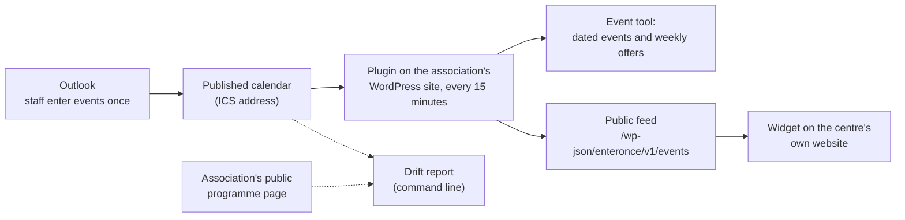

# Enter Once Sync

**Einmal erfassen, überall anzeigen.** A WordPress plugin that reads a neighbourhood centre's public calendar and keeps the events on an association website in step with it, so that nobody types an event twice.

> **Deutsch:** Dieses Projekt ist ein Geschenk an das Quartierzentrum Union in Basel und den Verband Quartiertreffpunkte Basel. Die Anleitungen auf Deutsch liegen in [`docs/de/`](docs/de/); beginnen Sie mit dem [Begleitbrief](docs/de/Begleitbrief.md). Was getestet ist und was nicht, steht im [Testbericht](docs/de/Testbericht.md).

## Status

Version 0.1.0, built in November 2026 by a volunteer after the AI for Access Hackathon in Basel (20–21 November 2026), where Quartierzentrum Union posed the challenge.

**It has only been tested against local stand-ins.** It has never run against the association's real event tool, a real Outlook or Google calendar, or the real websites, because the author has no access to them. A first installation therefore starts in dry-run mode and writes nothing until a person has checked the field mapping. [`docs/de/Testbericht.md`](docs/de/Testbericht.md) lists what was tested and what was not.

## The problem

The centre's staff enter every public event in Outlook. To show it on the association's website (WordPress) they type it again by hand into the association's event tool. The centre's own website shows the same events a third way, through a Google calendar, a script and an external widget service.

## What this does



- **Sync.** The plugin reads the published calendar, creates and updates events in the association's existing event tool and takes cancelled or removed ones offline (set to draft, never deleted). A weekly series becomes one "weekly offer" with holiday breaks and single cancellations, the way the site already shows them.
- **Screening.** Internal bookings are dropped. Names and addresses of people in the calendar are never transferred.
- **Safeguards.** A removal only happens after two consecutive runs agree, and a run that would remove more than five records stops and waits for a person.
- **Feed and widget.** The same events are offered as a public JSON feed. A dependency-free script shows them as a calendar and as highlights on the centre's own website.
- **Drift report.** A separate command compares the calendar with the association's public programme page and writes an HTML report: what is missing, what differs, what is cancelled but still online. It needs no installation on the website.

## Repository layout

| Path | Content |
|---|---|
| `src/Core/` | Calendar logic in plain PHP: parse, screen, expand recurrences, map, diff. No WordPress, no network, no system clock. |
| `src/WordPress/`, `enter-once-sync.php` | The plugin: adapter for the event tool, setup wizard, adoption of existing records, settings, scheduler, mails, feed. |
| `src/Drift/`, `bin/enteronce-drift` | The drift report. |
| `widget/` | The calendar widget (one script, one stylesheet) with its tests. See [`widget/README.md`](widget/README.md). |
| `docs/de/` | Eight German guides for the people who install, operate and use it. |
| `docs/dev/` | Developer notes and the implementation plan. |
| `tests/` | Unit tests (core, drift), WordPress integration tests, fixtures. |
| `dev/wordpress/` | Local test site with a stand-in for the association's event tool, and the build and check scripts. |
| `dev/pdf/`, `bin/build-pdf` | Renders the German guides to PDF. |
| `bin/` | Wrappers that run PHP, Composer and PHPUnit in Docker, and the build commands. |

## Requirements

- To run the plugin: WordPress 6.0 or newer, PHP 8.1 or newer, an event tool with the post type `events` and the taxonomies `topic`, `targetgroup` and `location_cat`, and one published calendar address (ICS, https) per centre.
- To develop: Docker and a Bash shell (Git Bash on Windows). PHP is not needed on the host. Node 20 or newer for the widget tests and the PDF guides; Edge, Chrome or Chromium for the PDFs.

## Getting started

```bash
dev/wordpress/start     # local site on http://localhost:18471, installs dependencies on first start
dev/wordpress/test      # all tests, the builds, a clean install of the zip, the package check
dev/wordpress/stop
```

The local login is printed by `dev/wordpress/start`; it is a throw-away value that exists only inside this Docker setup. The local site is for one person at a time: the tests delete its events and options.

Only the unit tests of the core and the drift report:

```bash
bin/composer install
bin/phpunit
```

The widget:

```bash
cd widget
npm ci
npm test
```

## Building

```bash
bin/build-zip        # dist/enter-once-sync.zip, the installable plugin
bin/build-package    # dist/enter-once-uebergabe.zip: plugin zip, guides (Markdown and PDF), drift report, source
```

`bin/build-package` renders the PDFs on the host with Node and a Chromium browser. Without them, `EO_NO_PDF=1 bin/build-package` builds the package with the Markdown guides only.

## Documentation

| For | Read |
|---|---|
| Deciding whether to use it | [`docs/de/Begleitbrief.md`](docs/de/Begleitbrief.md), [`docs/de/Testbericht.md`](docs/de/Testbericht.md) |
| Installing it on the association's site | [`docs/de/Installationsanleitung.md`](docs/de/Installationsanleitung.md) |
| The assumptions made, and how to change each one | [`docs/de/Entscheidungen.md`](docs/de/Entscheidungen.md) |
| Staff who enter events | [`docs/de/Kurzanleitung-Team.md`](docs/de/Kurzanleitung-Team.md) |
| The calendar source (Google now, Outlook later) | [`docs/de/Outlook-Anleitung.md`](docs/de/Outlook-Anleitung.md) |
| The widget on the centre's own website | [`docs/de/Website-Anleitung.md`](docs/de/Website-Anleitung.md) |
| The drift report | [`docs/de/Abgleichsbericht.md`](docs/de/Abgleichsbericht.md) |
| Developers | [`docs/dev/wordpress.md`](docs/dev/wordpress.md), [`docs/dev/core-api.md`](docs/dev/core-api.md), [`docs/dev/drift.md`](docs/dev/drift.md), [`widget/README.md`](widget/README.md) |
| The full design, with every rule and open question | [`docs/dev/IMPLEMENTATION_PLAN.md`](docs/dev/IMPLEMENTATION_PLAN.md) |
| Coding agents and their operators | [`AGENTS.md`](AGENTS.md) |

## What is not in this repository

- **No calendar address.** A published calendar address lets anyone who knows it read the whole calendar. It is entered in the plugin's settings and nowhere else. Never commit one.
- **No copy of the centre's website.** The widget demo and a few of its tests use copies of two pages of union-basel.ch. That content belongs to Quartierzentrum Union, so it stays out; those tests are skipped when the copy is missing.
- **No build output.** `vendor/`, `node_modules/` and `dist/` are created by the commands above.

## Ground rules for anyone who continues this work

- Do not send automated requests to the association's or the centre's website, or to a real calendar, while developing. The tests run offline against fixtures.
- Do not run the drift report against the live programme page before the association has been told what it does. It reads only the public page, at most once per hour.
- Everything a user sees is German in Swiss spelling (ss, never ß). Code, comments and developer notes are English.

## Maintenance

After the handover the centre and the association run the plugin themselves. Nothing in it depends on an account or server of the author, and nobody is paid to maintain it. Issues and pull requests are welcome, without a promise of response time.

## Licence

GPL-2.0-or-later, see [`LICENSE`](LICENSE). No warranty. Bundled at build time: `sabre/vobject`, `sabre/xml`, `sabre/uri` (BSD-3-Clause).
